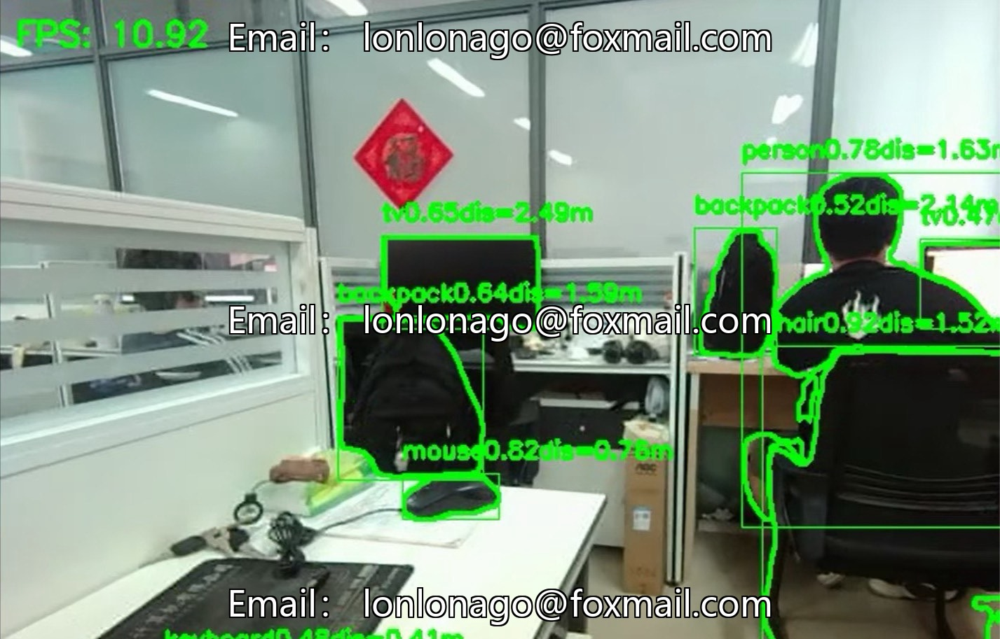
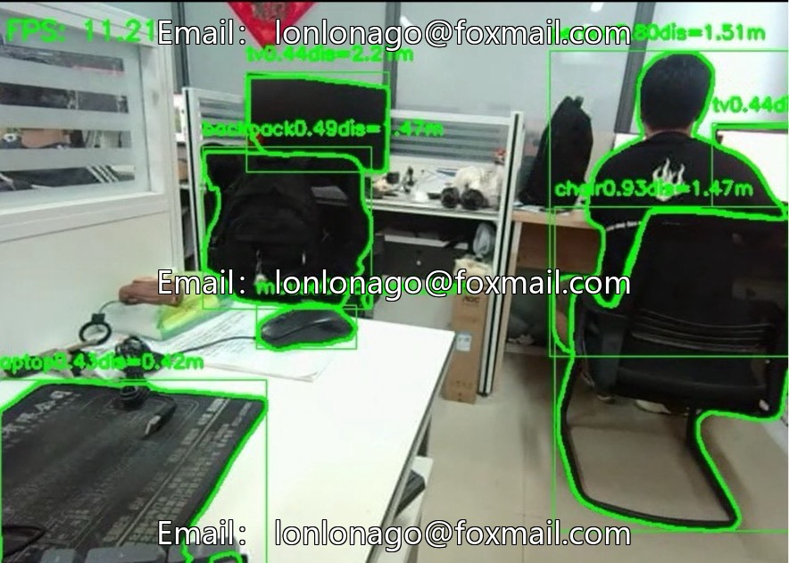

# YOLOv8+SGBM binocular stereo vision ranging system, supports land/underwater dual

## Body

YOLOv8+SGBM binocular stereo vision ranging system, supports land/underwater dual scenes, fuses instance segmentation and stereo matching algorithms, integrates target recognition, three-dimensional reconstruction, precise ranging into one, adapts to unmanned vehicles, drones, underwater vehicles and so on.

Two-channel parallel processing: YOLOv8-Seg outputs target categories and pixel-level masks from the channel, with inference up to 80FPS, supports custom training; SGBM outputs disparity/depth maps, balances accuracy and efficiency, adapts to different baseline binocular devices.

**Version Features**
- **Land Version**: Optimizes sunlight color representation, adapts to fast-moving scenes, and includes pre-trained models for road targets such as vehicles and pedestrians.
- **Underwater Version**: Red channel compensation algorithm, optimizes matching in turbid water bodies, and includes pre-trained models for underwater obstacles like corals and sunken ships.

**Model Training**
- Data: Collect scene images, label masks with Labelme, at least 500 instances per category.
- Performance: Test set mAP50-95 ≥ 0.6, inference speed > 30FPS, adapt to underwater red channel compensation, underwater blur data enhancement, and fine-tune pre-trained models.

**Deployment and Performance**
- **Hardware**
  - **Underwater Version**: Waterproof binocular camera, Jetson AGX Orin, 32GB memory, 1TB SSD
  - **Land Version**: Global shutter camera, Jetson Xavier NX, 16GB memory, 512GB SSD
- **Performance Metrics**
  - **Underwater Scenarios**: mAP@0.5 reaches 89.2%, depth error within 2 meters is less than 5%, 28FPS at 720p
  - **Land Scenarios**: Pedestrian detection rate is 98.3%, depth refresh rate is 60Hz, end-to-end latency is less than 50ms

- **Extension Direction**: Supports multi-sensor fusion, semantic SLAM, INT8 model quantization, and SGBM parameter adaptation, with modular design facilitating integration.

Virtual materials, once sold, are non-refundable.
Interested friends, click "I want" to proceed.

## Images

## Payment

Here is a pay link on Stripe ( https://buy.stripe.com/3cs8yP7sY87d0vu9AB ). Please contact me lonlonago@foxmail.com after funding $89, and I will send you a complete data files , thank you!

